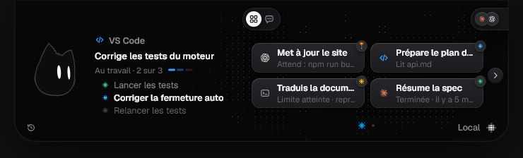
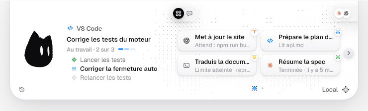
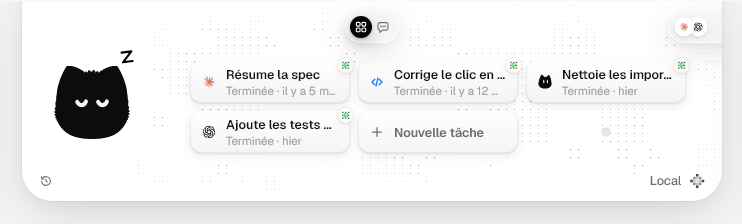
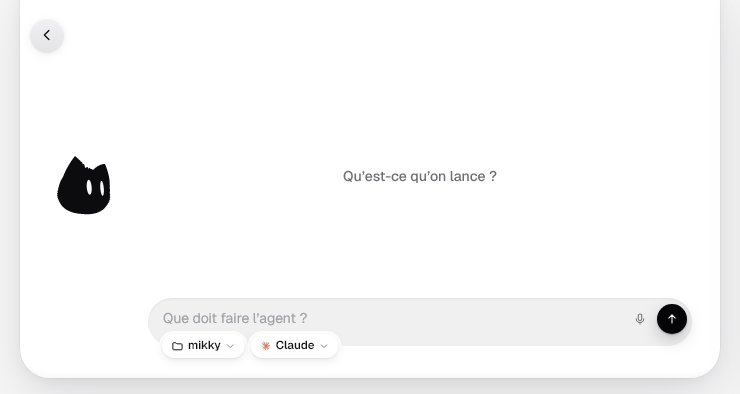
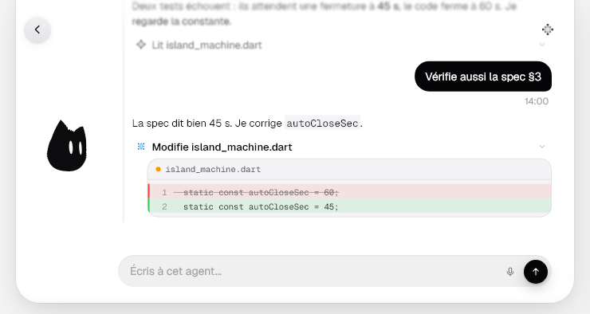
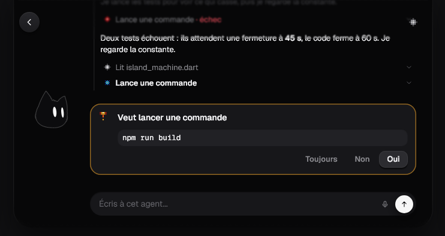
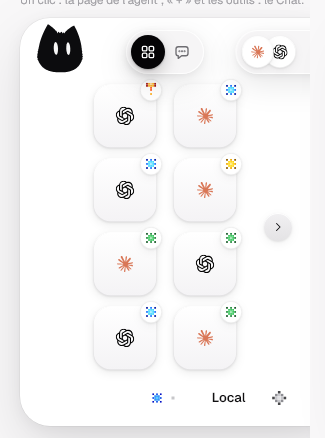
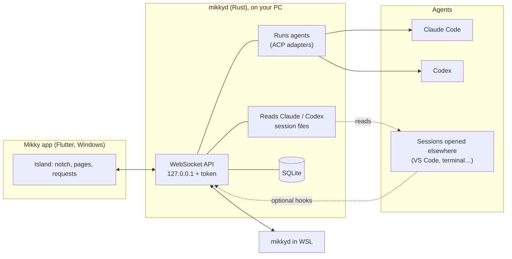

# Mikky

[](https://github.com/Gearleur/Mikky/actions/workflows/ci.yml)
[](LICENSE)

**A small black cat that lives at the top of your screen and watches over your coding agents.**
Mikky launches and follows Claude Code and Codex, shows where every task stands, and brings you their requests
("can I run `npm run build`?") so you answer in one click instead of digging through terminals.



> **Status:** early, personal project. Windows only for now (Linux is planned). Everything runs **locally**:
> no account, no server, no telemetry.

## Features

- **Lives in an island at the edge of the screen.** Closed, it is a small pill at the top center (or a tab on the
  right edge). On hover it opens into a **notch**: Mikky and what is going on.
- **Watches the latest task.** Next to Mikky: the app it runs in (VS Code, a terminal, the Claude or Codex app), its
  title, state, progress and steps. When nothing runs, Mikky falls asleep.
- **Shows every task as an app tile.** Waiting tasks come first, finished ones stay for a while, the rest goes to the
  history.
- **Launches agents.** Pick a folder, a model and a prompt; the agent starts on Windows or in WSL.
- **Follows sessions started elsewhere.** A Claude Code session opened in VS Code or a terminal shows up on its own.
- **Brings you the requests.** When an agent wants to run a command or asks a question, Mikky comes out with the
  request and its context (task, step, what the agent just said and did). Answer **Yes / No / Always**. Optional
  Claude Code and Codex hooks route the requests of outside sessions through Mikky; installing them always shows the
  change first.
- **Shows an agent's conversation** in order: what it said, the files it read and changed, the commands it ran.
  You can write to it to keep going, even while it works.
- **Tracks plan limits.** When Claude or Codex hits its limit, Mikky tells you when it lifts and can restart the
  agent then.
- **Reacts, a little.** Mikky changes expression with his agents, plays discreet sounds (bring your own) and sends
  Windows notifications. Global shortcuts: **Ctrl + Alt + A** (pending request), **Ctrl + Alt + Space** (open /
  close), **Ctrl + Alt + M** (mute).

Mikky is **not** an agent or an agent harness: it has no model of its own. It runs the official tools (Claude Code,
Codex) on **your subscriptions** and follows them.

## Screenshots

| A task at work | Nothing running: Mikky sleeps |
|---|---|
|  |  |

| A new chat | An agent's page |
|---|---|
|  |  |

| A request to approve | On the right edge |
|---|---|
|  |  |

## How it works



- **The Flutter app is only a screen.** The island is a transparent, click-through window whose shape is drawn by a
  shader. Closing the app stops no agent.
- **`mikkyd`, the Rust daemon, does all the agent work.** It launches Claude Code and Codex through their ACP
  adapters (`claude-agent-acp`, `codex-acp`), on Windows or in WSL, each in a job object so it can stop the whole
  process tree. It holds permissions and questions even with no screen open, reads session files to follow outside
  sessions, and keeps its metadata in SQLite.
- **App and daemon talk locally.** The WebSocket only listens on `127.0.0.1`, behind a token kept in the Windows
  credential store. WSL runs its own daemon, linked to the Windows one.
- **Hooks are optional.** `mikky-hook` is a tiny relay that Claude Code and Codex call to route their requests
  through Mikky. It never blocks the agent: without an answer, it hands control back.

| Folder | Contents |
|---|---|
| [`app/`](app/) | Flutter app: the island, the notch, the pages, the design boards (`lib/boards/`) |
| [`daemon/`](daemon/) | Rust workspace: `mikkyd`, `mikky-acp`, `mikky-hook` |
| [`packages/mikky_engine/`](packages/mikky_engine/) | Pure Dart core: Mikky, the island rules, sessions and their events |
| [`packages/mikky_agents/`](packages/mikky_agents/) | Dart client of `mikkyd`: what the island and the home show |
| [`scripts/`](scripts/) | Build, checks and board pictures |

## Getting started

**To build:** [Flutter](https://docs.flutter.dev/get-started/install/windows/desktop) for Windows, Visual Studio
with the "Desktop development with C++" workload, and [Rust](https://rustup.rs) (the version is pinned in
`daemon/rust-toolchain.toml`). For WSL agents, Rust inside WSL too.

**To run agents:** Node.js 22 or later on Windows, and Claude Code and/or Codex installed and signed in. The daemon
installs its ACP adapters the first time it launches an agent; WSL is optional.

```powershell
.\scripts\Build-Windows.ps1 -FlutterRoot C:\path\to\flutter   # builds a dated bundle in dist\
.\Start-Mikky.ps1                    # the island
.\Start-Mikky.ps1 -Boards            # the design boards
.\Start-Mikky.ps1 -InstallStartup    # island and daemon at Windows startup
```

The island is hidden at start: move the mouse to the top center of the main screen (or the middle of the right
edge) to bring it out. Right-click opens the settings menu.

Sounds are not shipped: the ones used during development are not ours to publish. Put your own `.mp3` files in
`app/assets/sounds/` (see its [README](app/assets/sounds/README.md)); without them, Mikky stays silent.

## Development

One script runs every check, locally and on CI: formatting, analysis, the no-repeated-code guard, and the tests of
the daemon, the engine, the agents client and the app.

```powershell
.\scripts\Check.ps1                  # everything
.\scripts\Check.ps1 -Only app        # one section: quality, rust, engine, agents, app
.\scripts\Check.ps1 -Fix             # format first
```

- Dart is formatted at 120 columns; Rust uses `cargo fmt` and clippy with `-D warnings`.
- The agents client tests start the `mikkyd` built in `daemon/target/debug`: `Check.ps1` builds it first.
- Tests replay real recorded Claude and Codex sessions. The WSL scenario runs with `MIKKY_TEST_WSL=1`.
- Golden tests (tagged `golden`) compare the boards with reference pictures kept out of git; they are skipped when
  `app/test/goldens/` is missing.
- The design boards (`mikky.exe --kit`) show the app's real screens in each of their states, light and dark; they are
  where visual changes are tried first.
- Commits follow [Conventional Commits](https://www.conventionalcommits.org) with the folder as scope, e.g.
  `feat(daemon): …`, `fix(app): …`.

## Privacy and security

- No telemetry, no account, no server: everything stays on your machine.
- Secrets (the daemon token) live in the Windows credential store, never on disk or in git.
- Mikky reads Claude and Codex session files on your machine to show them to you; nothing leaves it.
- Every permission goes to you by default. The automatic mode only exists when you pick it for a launch.

## License

[MIT](LICENSE). Third-party assets keep their own licenses: tool icons from
[Lobe Icons](https://github.com/lobehub/lobe-icons) and [Paperclip](https://github.com/paperclipai/paperclip)
(MIT, `app/assets/brands/`) and fonts under the SIL Open Font
License (`app/assets/fonts/OFL.txt`). Claude, Codex, OpenAI, Gemini and the other product names and logos are
trademarks of their owners, used only to name the tools Mikky works with.
