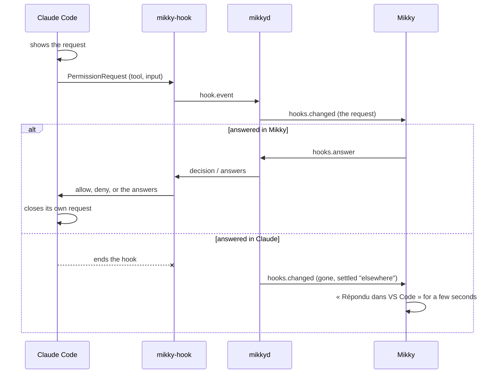

# Agents and their requests

How Mikky follows Claude Code and Codex, and how a permission or a question reaches you and goes back to the agent.
This is the heart of Mikky today: the rest of the app (the island, the home, the pages) shows what is described here.

## The pieces

| Piece | Where | Job |
|---|---|---|
| **Mikky** (Flutter) | `app/`, `packages/mikky_agents/`, `packages/mikky_engine/` | Shows sessions and requests, sends your answers. Decides nothing about a request. |
| **`mikkyd`** (Rust) | `daemon/mikkyd/` | Launches agents, reads session files, holds requests, checks and converts answers. |
| **`mikky-hook`** (Rust) | `daemon/mikky-hook/` | The tiny relay Claude Code and Codex run on each hook event. It finds `mikkyd` through the Windows credential store and passes the event on. |

App and daemon talk over a WebSocket on `127.0.0.1`, behind a token kept in the Windows credential store. Closing the
app stops no agent.

## Three kinds of sessions

| Where the agent runs | Mikky sees it | Mikky can answer | How |
|---|---|---|---|
| **Launched from Mikky** | yes | everything: permissions, questions, messages, pause, relaunch | `mikkyd` runs the agent through its ACP adapter (`claude-agent-acp`, `codex-acp`) |
| **Elsewhere, hooks installed** (terminal, VS Code, Claude's app) | yes | permissions and questions | the hooks: Claude asks, `mikkyd` holds the request, you answer here or there |
| **Elsewhere, no hooks** | yes | no: Mikky shows the question and takes you to the app | `mikkyd` reads the session file |

Sessions started elsewhere are found by reading Claude's and Codex's session files (`daemon/mikkyd/src/sessions/`),
on Windows and in WSL. A click on such an agent opens its page; Ctrl + click brings its terminal or VS Code forward.

## A request from a session started elsewhere

Claude Code calls its `PermissionRequest` hook **while it shows the request itself**. Its own question or permission
stays on screen and can be answered there; Mikky shows the same request at the same time. The first answer wins and
nobody waits on the other.

- **Permissions** (Bash, Edit, Write…): Mikky shows the command or the file, and answers Oui / Non. « Toujours » is a
  yes for the hooks.
- **Questions** (`AskUserQuestion`): the same hook, for Claude's question tool. Mikky shows the questions on one card;
  its answers go by question key (`q1`, `q1_custom` for free text), as for an agent launched from Mikky. `mikkyd` turns
  them into Claude's format (by question text) and the relay allows the tool with them as its input.
- **Answered elsewhere**: when Claude ends the hook, or the session's next event arrives (`PostToolUse`,
  `PostToolUseFailure`, `Stop`…), the request leaves Mikky and the agent says « Répondu dans VS Code » (or « dans
  Claude », « dans le terminal »).
- **Nobody answers**: `mikkyd` lets go after 105 s (the relay after 110 s, Claude's own limit is 120 s). Claude's own
  request is still there; the agent says « Toujours en attente dans… ».
- **Never block the agent**: no `mikkyd`, no screen open, a session `mikkyd` runs itself, answers that do not fit, or
  anything unexpected: the relay prints nothing and exits at once, as if Mikky were not installed.

Until 2026-10-13, questions came through a `PreToolUse` hook. Claude calls it *before* it shows the question, so
holding it blocked Claude's own window. The relay now ignores that old hook, and installing the hooks again removes it.

### Without the hooks

Mikky still reads the session file. A question appears with its choices, but Mikky cannot answer it: a click on a
choice, or « Répondre dans Claude », brings the app forward. Permissions do not appear: the file does not say that a
tool is waiting for one.

## The hooks

Installed in `~/.claude/settings.json` (Claude Code) or `~/.codex/hooks.json` (Codex) by `mikkyd`
(`daemon/mikkyd/src/hooks/settings.rs`), never without you: Mikky shows the exact change first, keeps a dated copy of
the file, and refuses to write a file changed since you saw it. Your own hooks are kept as they are.

| Event | Timeout | Why |
|---|---|---|
| `PermissionRequest` | 120 s | permissions and questions, held while you answer |
| `PostToolUse`, `UserPromptSubmit`, `Stop`, `SessionEnd` | 10 s | the session moved on: a request it waited on is settled |
| `PostToolUseFailure` (Claude), `Interrupt` (Codex) | 10 s / 3 s | a tool was refused, failed or interrupted |

The relay lives at a fixed place, `%LOCALAPPDATA%\Mikky\bin\mikky-hook.exe`, so a new build of Mikky does not leave
Claude calling an old folder. `mikkyd` replaces it at start when the shipped one differs.

**Install or update:** right-click the island (or Mikky's icon in the notification area) → « Hooks Claude Code… » or
« Hooks Codex… ». The page says whether they are installed and up to date; « Mettre à jour… » shows the change, then
« Installer » writes it.

## Messages to a session started elsewhere

A Claude session working in a terminal can receive a message from Mikky: it waits in `mikkyd`
(`daemon/mikkyd/src/hooks/messages.rs`) and the relay hands it to Claude at the session's next `PostToolUse` or
`Stop`, as context from the user. A session that is not working is resumed by Mikky itself (an ACP launch on the same
session). That is how « Relance auto » takes a task up again once a subscription limit lifts.

## Not covered yet

- Hooks on Linux and in WSL: the relay finds `mikkyd` only through the Windows credential store.
- Codex started elsewhere: its permissions use the same hook; its questions are only read from its session file.
